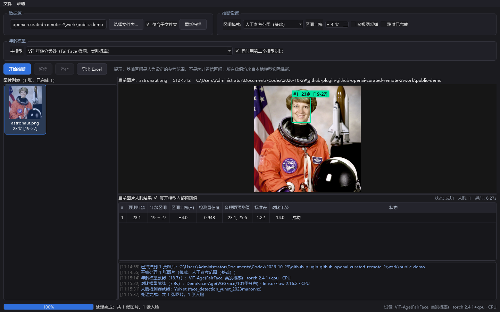

# 人脸年龄评估与准确率审计工具

Windows 本地人脸年龄区间评估软件，包含批量图片推断、人工标注复查、双模型对比、Excel 导出及独立准确率统计脚本。发布包包含 Python 运行环境、所需依赖和模型权重，解压后即可启动。

## 实际导入与推断效果

下图由程序实际导入 NASA 公开宇航员照片、执行双模型推理后截取，包含人脸框、主模型预测、参考年龄区间和第二模型结果。示例主模型输出约 23.1 岁，第二模型约 14.0 岁；这是实际运行输出，**不是照片人物的真实年龄，也不能用作准确率证明**。截图特意保留模型分歧，供了解界面和工具局限。



演示素材来源：[scikit-image 的 NASA astronaut 样例](https://github.com/scikit-image/scikit-image/blob/v0.19.3/skimage/data/astronaut.png)。来源与重现方法见 [演示图片说明](docs/演示图片说明.md)。未使用私人照片或个人标注截图。

## 下载与启动

**[下载完整可运行版](https://github.com/ylele1479-collab/age-face-evaluator/releases/latest)**，选择 `AgeFaceEvaluator-Windows-Full-2026.10.29.zip`。

1. 将压缩包全部解压到有足够空间、可写的目录。
2. 双击 `Check-Installation.bat` 检查本地依赖和模型。
3. 双击 `Start-Age-Evaluation.bat` 进入批量年龄评估。
4. 需要检查已有 JSON 标注时，双击 `Start-Review.bat`。

运行环境：Windows 10/11 x64；CPU 推理，不要求独立显卡。建议至少 8 GB 内存，双模型/大批量任务建议 16 GB；这些是使用建议，本次未在该最低配置实测。解压需要约数 GB 空间，后续结果、备份和缓存还需要额外空间。

**仓库“Download ZIP”只含源码、文档和脚本；完整 Python 依赖与大模型在 Releases 完整包中。普通用户必须下载完整包。** 不需要另外安装 Python、TensorFlow、PyTorch 或手动下载模型。

## 功能介绍

| 模块 | 功能 |
|---|---|
| 文件夹扫描 | 批量读取图片，支持包含子目录及重新扫描 |
| 人脸检测 | 本地 YuNet 检测人脸，支持一张图多人脸 |
| 年龄推断 | DeepFace 表观年龄模型或 ViT 年龄分类器 |
| 双模型对比 | 同时运行第二个模型，辅助识别结果分歧 |
| 多视图采样 | 使用不同裁剪/翻转视图综合推断 |
| 年龄区间 | 提供人工参考范围、概率分布及校准相关选项 |
| 批量控制 | 开始、暂停、停止、跳过已完成与断点状态 |
| Excel 导出 | 导出推断结果、模型信息和人脸结果 |
| 复查助手 | 读取图片及 JSON 标注，对照人工年龄与模型预测 |
| 复查筛选 | 按误差、已保存状态等条件筛选，支持快速定位 |
| 标注维护 | 保存合格候选、提取指定误差图片、补全缺失性别等 |
| 原工具同步 | 可选同步特定旧版标注窗口，依赖对应外部旧工具 |
| 独立审计 | 从逐条预测重算 MAE、RMSE、偏差、阈值命中率及 20 岁分界指标 |

程序内年龄结果表示模型对照片外观的估计，与人的真实年龄可能有明显差异。复查界面的颜色和取整误差不能代替独立的浮点准确率计算。

## 模型与完整包内容

| 模型/组件 | 用途 | 随包情况 |
|---|---|---|
| DeepFace Age / VGGFace | 101 类年龄概率分布 | 包含权重 |
| `nateraw/vit-age-classifier` | FairFace 微调的 ViT 年龄分类器 | 包含配置、处理器及权重 |
| DeepFace Gender / VGGFace | 复查中的辅助性别候选 | 包含权重 |
| YuNet ONNX | 人脸检测 | 包含权重 |
| `genderage.onnx` | 本机已有的辅助模型资源 | 包含，不代表所有入口均使用 |
| Python 3.12、PySide6、NumPy、OpenCV、Pillow | 运行环境与界面 | 完整包内提供 |
| TensorFlow、tf-keras、DeepFace、PyTorch、Transformers | 模型加载和 CPU 推理 | 完整包内提供 |

启动脚本按相对路径定位运行环境和模型。Hugging Face 缓存中的符号链接已转换成普通文件，解压不需要开发者模式或管理员权限。模型加载采用本地离线模式，缺少文件时会报告错误，不能靠联网下载掩盖漏包。

## 使用方法

### 批量评估

选择图片文件夹 → 选择模型和推断模式 → 根据需要开启多视图或第二模型 → 开始推断 → 检查结果 → 导出 Excel。

支持的主要格式为 JPG/JPEG/PNG/WEBP/BMP。多视图和双模型通常更慢、占用更多内存。首次加载模型也会比后续任务耗时。

### 复查已有标注

启动 `Start-Review.bat`，导入图片或文件夹。JSON 通常采用图片完整文件名加 `.json` 的同目录侧车形式，例如 `photo.jpg` 与 `photo.jpg.json`，内部使用 `result` 人脸数组、`box` 和年龄字段。

复查可筛选、定位和对照。涉及保存标注或补全性别的操作会按功能改写目标 JSON，并有备份逻辑；上传包没有附带私人图片、原始标注、工作状态或历史运行日志。

“同步旧版”仅适用于代码支持的特定外部标注工具，完整包没有附带该外部软件。独立的年龄评估、复查和统计不依赖它；没有旧工具时不要启用同步。此次仅验证便携启动和模型推理，未重新执行旧窗口同步的交互验收。

### 独立准确率统计

准备逐条预测 JSON 数组，每条至少有人工基准 `anno` 与预测 `pred`：

```json
[{"anno": 18, "pred": 19.2, "cake": 20}, {"anno": 25, "pred": 21.5}]
```

在完整包目录打开命令提示符：

```bat
Run-Audit.bat predictions.json --output audit-output\metrics.json
```

统计脚本读取输入并写出独立结果，记录输入 SHA-256，提供整体、年龄段和 20 岁阈值指标。提供 `cake` 时，会分别计算“更靠近人工标注”和“真实误差优于 Cake”，避免把两种统计混为一谈。它不会读取或改写图片、标注文件，也不会重新训练模型。

`audit/legacy/` 保留当时独立审计使用的原始脚本，含当时数据目录和快照假设，仅供方法追溯。日常使用上面的通用脚本，无需修改历史脚本。旧报告及解释见 [历史准确率审计](docs/历史准确率审计.md)；旧数字只适用于对应样本快照。

## 目录与数据

```text
Start-Age-Evaluation.bat   批量年龄评估
Start-Review.bat           复查助手
Check-Installation.bat     运行环境与模型自检
Run-Audit.bat              准确率统计入口
source/                   完整应用源码
audit/                    通用统计与历史审计脚本
runtime/                  随包 Python 和依赖（Releases）
models/                   模型权重及本地缓存（Releases）
data/AgeFaceTool/          本地模型、运行状态和后续标注备份
docs/                     使用与审计说明
```

## 结果解释与限制

- 表观年龄模型不是身份证年龄核验工具；结果需要结合人工复查。
- 训练分布、裁剪、人脸姿态、遮挡、清晰度和不同年龄段会影响误差。
- 校准区间的有效性依赖校准集与使用数据的匹配，不能仅凭区间名推断统计保证。
- 旧审计观察到 20 岁附近的区分能力有限，不能把总体命中率外推成该边界可靠。
- 包内参考图与第三方模型保留原有来源和适用条件；上游权重和依赖并不因本仓库公开而改换许可证。

第三方声明见 [THIRD_PARTY_NOTICES.md](THIRD_PARTY_NOTICES.md)。
